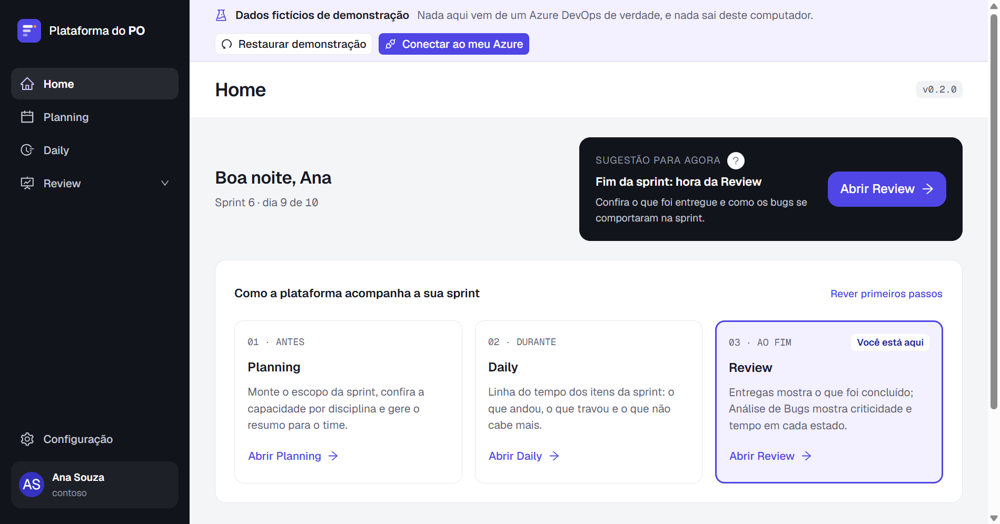
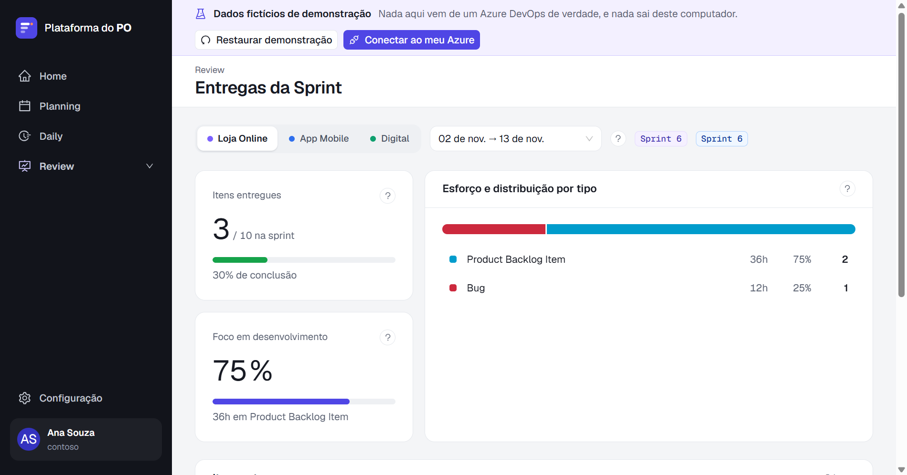
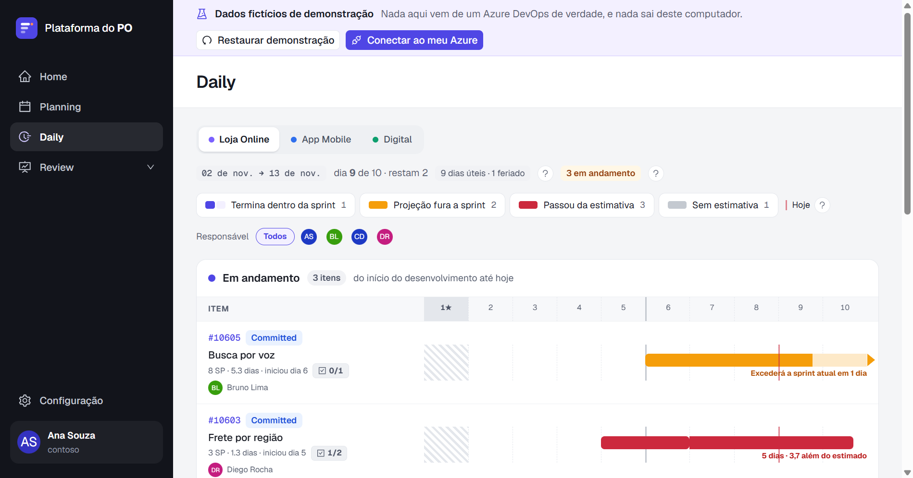
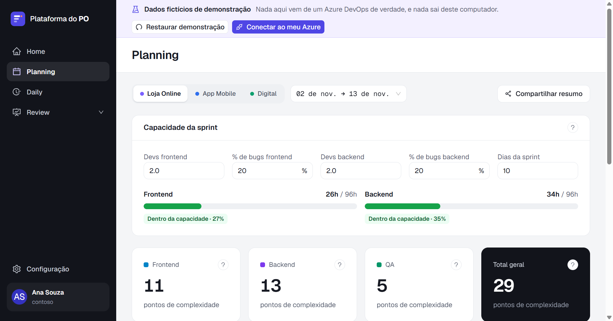

# Plataforma do PO

[Português](README.md) · **English**

A desktop dashboard for **Product Owners who work with Azure DevOps**: install it on
your machine, point it at your products and follow Planning, Daily, deliveries, bugs
and team performance without writing a single query.

> The app's interface is currently in Brazilian Portuguese.









- **Read-only.** The app never writes to Azure DevOps, not even with a PAT that
  would allow it.
- **Fully local.** No server, no account, no login. Your PAT is encrypted on your
  machine and only ever leaves it to reach Azure DevOps.
- **Configurable.** Products, process, calendar and fields live in a JSON file that
  you — or your AI assistant — can edit.

## Install

1. Download the `...-setup.exe` from the [latest Release](../../releases/latest).
2. **Check the SHA-256** published in the Release. In PowerShell:

   ```powershell
   (Get-FileHash .\plataforma-po-desktop-<version>-setup.exe -Algorithm SHA256).Hash.ToLower()
   ```

   It must match the Release exactly. The installer is built by GitHub Actions from
   the tag, and the build log is public.
3. Run the installer.

**Windows will show a SmartScreen warning** ("Windows protected your PC", unknown
publisher). The installer is **not code-signed**; that is expected at this stage.
Click **More info → Run anyway**. The SHA-256 above is what guarantees the file came
from the code.

Only a Windows installer is available for now.

## Create the PAT (read-only)

In Azure DevOps: **User settings → Personal access tokens → New Token**.

- **Organization:** only the organization you are going to follow.
- **Expiration:** the shortest that is practical for you.
- **Scopes:** **Custom defined**, and tick **only**:

| Scope | What for | Required |
|---|---|---|
| **Work Items → Read** | Work items, WIQL queries, history, iterations and area paths | Yes |
| **Project and Team → Read** | Listing projects and teams when configuring a Product | Yes |
| **Graph → Read** | Photo and name of people shown in the Daily and in the menu | No |

The Graph scope is behind **Show all scopes**. Without it everything works: photos
are replaced by initials.

Do not tick any write scope. The app refuses every write anyway (`RN-SEC-20`), but a
read-only PAT is the first barrier, and the simplest one.

## First run

Want to look around first? Choose **"Explorar com dados de exemplo"** (explore
with sample data): every screen opens with fictitious data, with no PAT and no
Azure organization, and nothing leaves the computer. A banner at the top reminds
you it is a demo and leads to the next step, creating the Profile with your own
Azure. The demo stays there afterwards.

To use it with your own data, the app asks for the Azure DevOps organization (the **name**, not
the URL) and the PAT. The PAT is tested against Azure before it is stored; if it
does not work, nothing is saved.

Then you build the Configuration in one of two ways:

- **Wizard:** the app lists the organization's projects, teams and area paths and
  you pick your Products.
- **Import:** bring a ready `configuracao.json` — from a teammate, for instance. The
  Configuration never contains the PAT, so it can be shared.

Each set of organization, PAT and Configuration is a **Profile**. You can have more
than one Profile on the same machine.

## Configure it with your AI

The Configuration is a JSON file with a schema, designed to be edited by humans
**and** by AI assistants (Claude, ChatGPT, Copilot, Cursor...).

1. In the app, open the Configuration and click **Open folder**.
2. Point your AI at that folder.
3. Ask for what you need — "the team treats `Ready for Release` as delivered", "add
   the municipal holiday on August 12".

The folder has an `AGENTS.md` that teaches the AI the vocabulary, what each section
does and what it must not touch. The PAT is **not** in that folder: it is stored
encrypted elsewhere, and the AI cannot read it from there.

If the AI produces an invalid file, the app tells you what is wrong and keeps
running with the last valid version.

## Sprint goal with your AI

In the Planning summary, the app builds a **request** to draft the sprint goal from
the checked items. You take the request to the AI you already use and bring the
answer back. The app **does not run any AI, does not talk to any AI service and
knows no one's AI account**: it works with Claude, ChatGPT, Copilot or any other.

1. Click **Copiar pedido para a sua IA** (copy request). The preview shows exactly
   what goes into the text: ID, title, state, Product, priority and description of
   the checked items. Anything shaped like a token is replaced with `[REDACTED]`.
2. Paste the request into your AI, as you would any question.
3. Copy the answer, click **Colar resposta** (paste answer) and then **Usar este
   texto** (use this text). Nothing goes into the summary unless you accept it.

Whatever you paste into an AI goes to that AI's account, under its terms. Check your
organization's policy on sending work data to an AI.

## How your PAT is protected

- Encrypted with the operating system's protection (DPAPI on Windows); if encryption
  is unavailable, the app refuses to store it.
- Only the main process reads the PAT. The interface has no operation that returns
  it, and no error carries it.
- The only network the app reaches with the PAT is your organization's
  `dev.azure.com`, and only to read.
- The PAT is scrubbed from every log and every error message.

Each item is a rule with an automated test that has already failed with the barrier
switched off. Details, and what the app does **not** protect against, in
[SECURITY.md](SECURITY.md). The list of guarantees in plain language, how to check
each one and the OWASP ASVS self-assessment are in [docs/seguranca.md](docs/seguranca.md)
(Portuguese).

## Run from source

Requires Node.js 24 and Windows (macOS and Linux build, but are not tested).

```bash
npm ci
npm run dev
```

Before opening a PR:

```bash
npm run check
```

Build the installer locally:

```bash
npm run build:win
```

The installer lands in `dist/`. How to contribute: [CONTRIBUTING.md](CONTRIBUTING.md)
(in Portuguese; PRs and issues in English are welcome).

## License

[GPL-3.0](LICENSE). You may use it, including at work, study it and modify it.
Whoever distributes a modified version must also distribute its source code, under
the same license.

## Author

Daniel Farias · [LinkedIn](https://www.linkedin.com/in/daniel-farias-198617272/) ·
[GitHub](https://github.com/fariasds)
