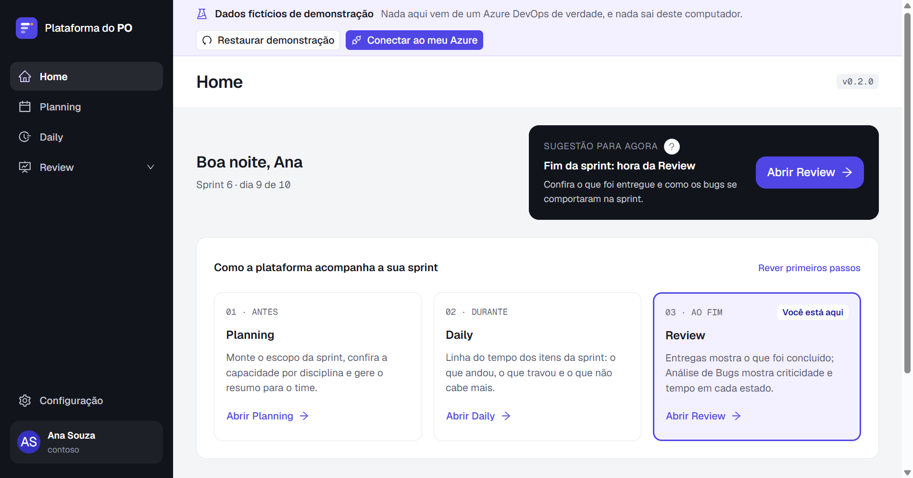
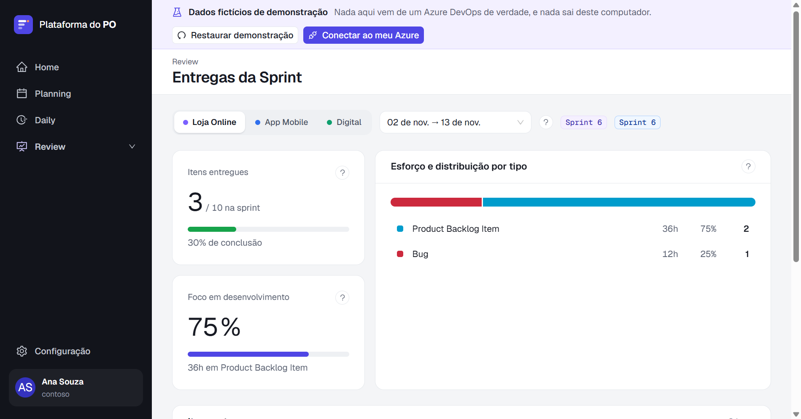
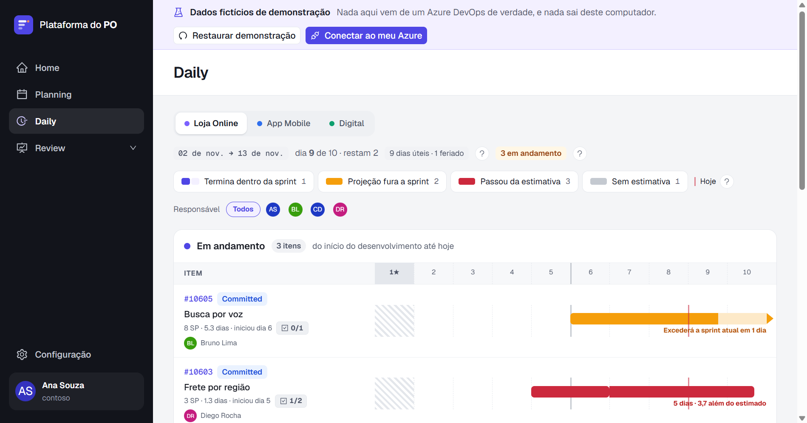
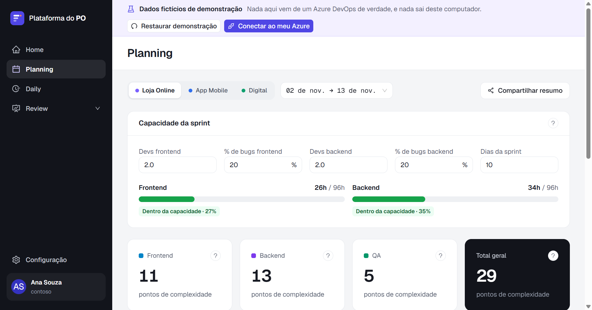

# Plataforma do PO

**Português** · [English](README.en.md)

Dashboard desktop para **Product Owners que trabalham com Azure DevOps**: você
instala na sua máquina, aponta para os seus produtos e acompanha Planning, Daily,
entregas, bugs e desempenho do time sem montar consulta nenhuma.









- **Só leitura.** O app nunca escreve no Azure DevOps, nem com um PAT que permita.
- **Tudo local.** Sem servidor, sem conta, sem login. O PAT fica cifrado na sua
  máquina e só sai para o Azure DevOps.
- **Parametrizável.** Produtos, processo, calendário e campos moram em um arquivo
  JSON que você — ou a sua IA — edita.

## Instalar

1. Baixe o `...-setup.exe` da [última Release](../../releases/latest).
2. **Confira o SHA-256** publicado na Release. No PowerShell:

   ```powershell
   (Get-FileHash .\plataforma-po-desktop-<versão>-setup.exe -Algorithm SHA256).Hash.ToLower()
   ```

   O valor precisa ser idêntico ao da Release. O instalador é construído pelo
   GitHub Actions a partir da tag, e o log do build é público.
3. Rode o instalador.

**O Windows vai mostrar o aviso do SmartScreen** ("O Windows protegeu o
computador", editor desconhecido). O instalador **não tem assinatura de código**,
e isso é esperado nesta fase. Clique em **Mais informações → Executar assim mesmo**.
A garantia de que o arquivo é o que saiu do código é o SHA-256 acima.

Por enquanto só há instalador para Windows.

## Criar o PAT (só leitura)

No Azure DevOps: **User settings → Personal access tokens → New Token**.

- **Organization:** só a organização que você vai acompanhar.
- **Expiration:** a menor que for prática para você.
- **Scopes:** **Custom defined**, e marque **apenas**:

| Escopo | Para quê | Obrigatório |
|---|---|---|
| **Work Items → Read** | Work items, consultas WIQL, histórico, iterações e area paths | Sim |
| **Project and Team → Read** | Listar projetos e times ao configurar um Produto | Sim |
| **Graph → Read** | Foto e nome de quem aparece na Daily e no menu | Não |

O escopo Graph fica atrás de **Show all scopes**. Sem ele tudo funciona: as fotos
dão lugar às iniciais.

Não marque nenhum escopo de escrita. O app recusa qualquer escrita de qualquer forma
(`RN-SEC-20`), mas um PAT só de leitura é a primeira barreira, e a mais simples.

## Primeira execução

Quer ver antes de configurar? Escolha **"Explorar com dados de exemplo"**: todas as
telas abrem com dados fictícios, sem PAT e sem organização no Azure, e nada sai do
computador. Uma faixa no topo lembra que os dados são de demonstração e leva ao
passo seguinte, criar o Perfil com o seu Azure. A demonstração continua lá depois.

Para usar com os seus dados, o app pede a organização do Azure DevOps (o **nome**, não a URL)
e o PAT. O PAT é testado contra o Azure antes de ser guardado; se não funcionar,
nada é gravado.

Depois disso você monta a Configuração de um destes jeitos:

- **Assistente:** o app lista projetos, times e area paths da organização e você
  escolhe os seus Produtos.
- **Importação:** traga um `configuracao.json` pronto — de um colega do mesmo time,
  por exemplo. A Configuração nunca contém o PAT, então pode ser compartilhada.

Cada conjunto de organização, PAT e Configuração é um **Perfil**. Dá para ter mais
de um Perfil na mesma máquina.

## Configurar com a sua IA

A Configuração é um JSON com schema, feito para ser editado por humanos **e** por
assistentes de IA (Claude, ChatGPT, Copilot, Cursor...).

1. No app, abra a Configuração e clique em **Abrir pasta**.
2. Aponte a sua IA para essa pasta.
3. Peça o que precisa — "o time considera `Ready for Release` como entregue",
   "adicione o feriado municipal de 12 de agosto".

A pasta tem um `AGENTS.md` que ensina à IA o vocabulário, o que cada seção faz e o
que ela não deve tocar. O PAT **não está** nessa pasta: ele mora cifrado em outro
lugar, e a IA não tem como lê-lo por ali.

Se a IA gerar um arquivo inválido, o app avisa o que está errado e continua com a
última versão válida.

## Objetivo da sprint com a sua IA

No resumo do Planning, o app monta um **pedido** para rascunhar o objetivo da sprint
a partir dos itens marcados. Você leva o pedido à IA que já usa e traz a resposta de
volta. O app **não executa IA, não fala com serviço de IA e não conhece conta de IA
de ninguém**: funciona com o Claude, o ChatGPT, o Copilot ou qualquer outra.

1. Clique em **Copiar pedido para a sua IA**. A prévia mostra exatamente o que vai
   no texto: ID, título, estado, Produto, prioridade e descrição dos itens marcados.
   Trechos com forma de token saem trocados por `[REDACTED]`.
2. Cole o pedido na sua IA, como faria com qualquer pergunta.
3. Copie a resposta, clique em **Colar resposta** e depois em **Usar este texto**.
   Nada entra no resumo sem você aceitar.

O que você colar numa IA vai para a conta dela, sob os termos dela. Confira a
política da sua organização sobre enviar dados de trabalho a uma IA.

## Como seu PAT é protegido

- Cifrado com a proteção do sistema operacional (DPAPI no Windows); sem cifragem
  disponível, o app se recusa a guardá-lo.
- Só o processo principal lê o PAT. A interface não tem nenhuma operação que o
  devolva, e nenhum erro o carrega.
- A única rede que o app acessa com o PAT é `dev.azure.com` da sua organização, e
  só para leitura.
- O PAT é apagado de todo log e de toda mensagem de erro.

Cada item é uma regra com teste automatizado que já falhou com a barreira desligada.
Detalhes, e o que o app **não** protege, em [SECURITY.md](SECURITY.md). A lista de
garantias em linguagem simples, como conferir cada uma e a autoavaliação OWASP ASVS
estão em [docs/seguranca.md](docs/seguranca.md).

## Rodar a partir do código

Requer Node.js 24 e Windows (macOS e Linux compilam, mas não são testados).

```bash
npm ci
npm run dev
```

Antes de abrir um PR:

```bash
npm run check
```

Gerar o instalador localmente:

```bash
npm run build:win
```

O instalador sai em `dist/`. Como contribuir: [CONTRIBUTING.md](CONTRIBUTING.md).

## Licença

[GPL-3.0](LICENSE). Você pode usar, inclusive no trabalho, estudar e modificar.
Quem distribuir uma versão modificada precisa distribuir também o código dela, sob a
mesma licença.

## Autor

Daniel Farias · [LinkedIn](https://www.linkedin.com/in/daniel-farias-198617272/) ·
[GitHub](https://github.com/fariasds)
